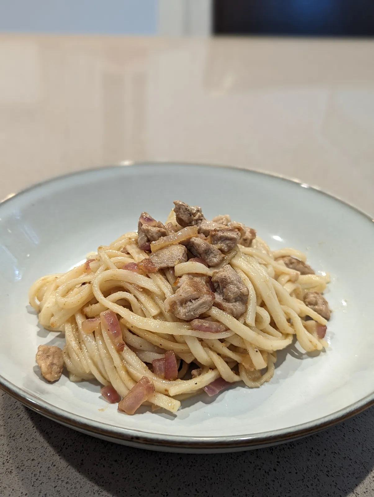
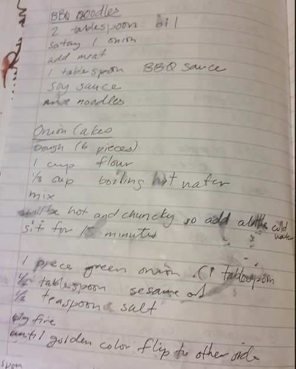

## Ingredients

-   2 T Oil (Olive Oil, Vegetable Oil, etc.)

-   0.5 Small Onion

-   0.5 cup thinly sliced pork

-   1 T Chinese BBQ Sauce

-   0.5 T Soy Sauce

-   2 bunches of Dry Udon Noodles

## Directions

1.  Cook udon noodles according to package instructions and set aside.
2.  Chop the onion and sauté in oil in a pan.
3.  Add meat to the pan. Stir and cook through.
4.  Add BBQ and soy sauce to the pan.
5.  Mix in noodles and serve.

{width=50%}

## Source

