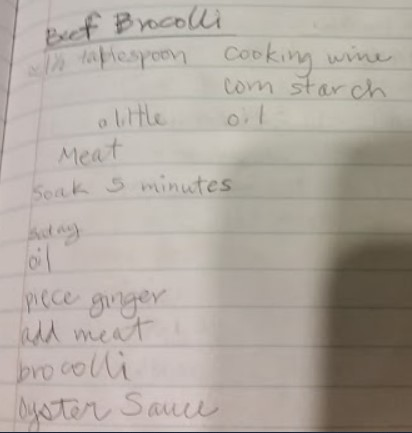

## Ingredients

#### Marinade

- ½ tablespoon cooking wine
- Cornstarch
- A little oil
- Beef

#### Stir-fry

- Oil
- 1 piece ginger
- Broccoli
- Oyster sauce

## Directions

1. Mix the beef with the cooking wine, cornstarch, and a little oil. Let it soak for 5 minutes.
1. Heat oil in a pan and add the ginger.
1. Add the beef.
1. Add the broccoli.
1. Add oyster sauce.

## Notes

- The card has no amounts for the beef, cornstarch, broccoli, or oyster sauce, and doesn't say what cut of beef or how to slice it (flank steak sliced thin against the grain is typical).
- The amount before "tablespoon cooking wine" is partly cut off; it reads as "½".
- A small word above the second "oil" is hard to read (possibly "frying"). The order suggests heating the oil, frying the ginger, then adding the beef.
- No cooking times are given. It isn't clear whether the beef is cooked and removed before the broccoli goes in, or whether the broccoli is blanched first. The chicken-celery card notes "oil in beef broccoli," i.e. the oil goes in the beef marinade.

**Similar recipes to fill in details**

- [The Woks of Life: Beef and Broccoli](https://thewoksoflife.com/wprm_print/beef-and-broccoli): the same marinade (cooking wine, cornstarch, oil) and an oyster-sauce finish; gives amounts and times.
- [Once Upon a Chef: Beef and Broccoli](https://onceuponachef.com/?p=16357): gives beef, broccoli, and sauce amounts for a 1 lb batch.

## Source

