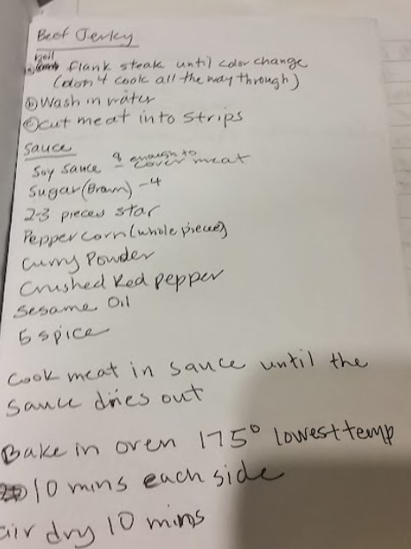

## Ingredients

- Flank steak

#### Sauce

- Soy sauce, enough to cover the meat
- 4 brown sugar
- 2-3 pieces star anise
- Peppercorns (whole)
- Curry powder
- Crushed red pepper
- Sesame oil
- Five-spice powder

## Directions

1. Boil the flank steak until the color changes. Don't cook it all the way through.
1. Rinse the meat in water.
1. Cut the meat into strips.
1. Cook the meat in the sauce until the sauce dries out.
1. Bake in the oven at 175° (lowest temperature), 10 minutes on each side.
1. Air dry for 10 minutes.

## Notes

- The amount of flank steak isn't given.
- "Sugar (Brown) – 4" has no unit. Tablespoons is the likely guess; 4 cups would be far too much.
- "2-3 pieces star" is assumed to mean star anise.
- No amounts are given for the peppercorns, curry powder, crushed red pepper, sesame oil, or five-spice powder.
- "175°" is assumed to be °F. The card calls it the lowest oven temperature.
- 10 minutes per side at 175°F is quite short for jerky; most recipes dry for hours. The cooking-down step in the sauce may account for some of that, but it's worth checking.
- The first word ("Boil") is written over a crossed-out word, and the original step number before "10 mins each side" is crossed out.
- How thick to cut the strips isn't stated.

**Similar recipes to fill in details**

- [Chinese Beef Jerky (CDKitchen)](https://www.cdkitchen.com/recipes/recs/438/Chinese-Beef-Jerky100669.shtml): simmers the strips in soy sauce, sugar, and star anise, then dries them. The closest method to this card.
- [Chinese-Style Beef Jerky (cooklist)](https://cooklist.com/recipe/chinese-style-beef-jerky-2566701): gives amounts for a soy/sugar/five-spice version.
- [Amazing Food Made Easy: Chinese 5-Spice Beef Jerky](https://www.amazingfoodmadeeasy.com/info/beef-jerky-recipes/more/chinese-5-spice-beef-jerky-recipe): useful for low-oven drying times.

## Source

