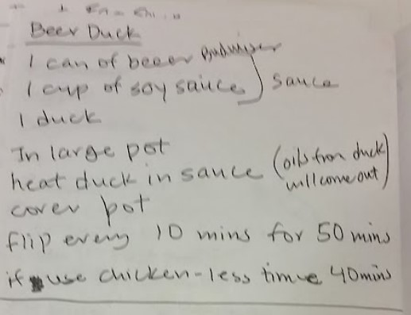

## Ingredients

- 1 duck

#### Sauce

- 1 can beer (Budweiser)
- 1 cup soy sauce

## Directions

1. Mix the beer and soy sauce in a large pot.
1. Heat the duck in the sauce. Oils from the duck will come out.
1. Cover the pot.
1. Cook for 50 minutes, flipping the duck every 10 minutes.

## Notes

- To use chicken instead of duck, cook for less time: 40 minutes.
- The card doesn't say whether the duck is whole or cut into pieces, or what heat to use (a simmer is likely).
- It isn't clear whether to skim off the duck fat or reduce the sauce at the end.
- There is a faint, cut-off line above the title that can't be read.

**Similar recipes to fill in details**

- [Omnivore's Cookbook: Beer Duck](https://omnivorescookbook.com/beer-duck/): braises duck pieces in beer and soy sauce; covers browning, heat level, and reducing the sauce.
- [Adam Liaw: Sichuan Beer Duck](https://adamliaw.com/recipe/sichuan-beer-duck): a spicier version with similar beer-and-soy braising.

## Source

