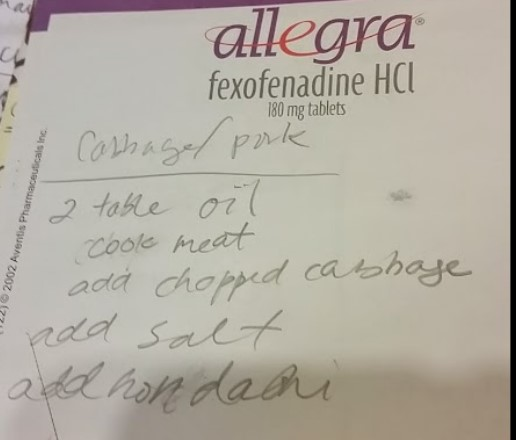

## Ingredients

- 2 tablespoons oil
- Pork
- Cabbage, chopped
- Salt
- Hondashi

## Directions

1. Heat 2 tablespoons oil and cook the pork.
1. Add the chopped cabbage.
1. Add salt.
1. Add Hondashi.

## Notes

- No amounts for the pork, cabbage, salt, or Hondashi (Japanese dashi granules).
- The cut of pork (sliced or ground) and the type of cabbage (green or napa) aren't specified.
- "2 table oil" is assumed to mean 2 tablespoons.
- The last line reads "add hondashi"; the handwriting runs together.
- No cooking times are given.

**Similar recipes to fill in details**

- [RecipeTin Japan: Chinese Cabbage Stir-Fry with Pork](https://japan.recipetineats.com/chinese-cabbage-stir-fry-with-pork): a light, Japanese-style pork and cabbage stir-fry; gives amounts and times.
- [Omnivore's Cookbook: Pork and Cabbage Stir Fry](https://omnivorescookbook.com/pork-and-cabbage-stir-fry): gives pork and cabbage amounts and cooking order.

## Source

