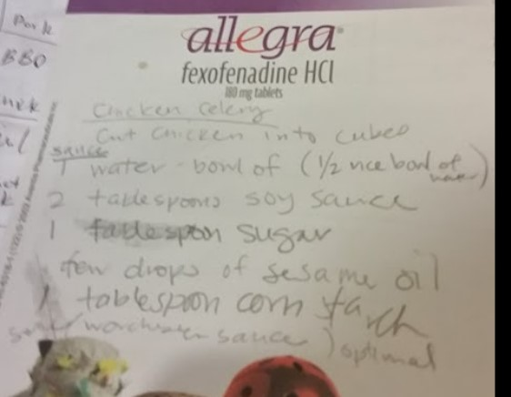
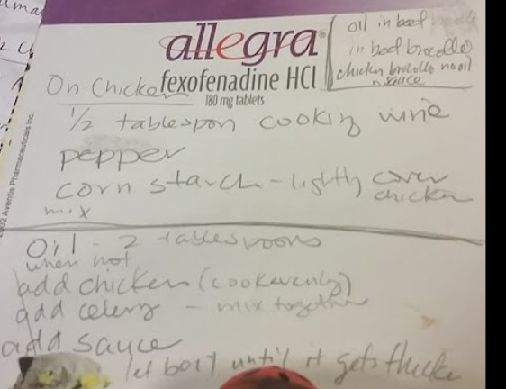

## Ingredients

- Chicken, cut into cubes
- Celery

#### On the chicken

- ½ tablespoon cooking wine
- Pepper
- Cornstarch, enough to lightly cover the chicken

#### Sauce

- ½ rice bowl water
- 2 tablespoons soy sauce
- 1 tablespoon sugar
- A few drops sesame oil
- 1 tablespoon cornstarch
- Worcestershire sauce (optional)

#### For cooking

- 2 tablespoons oil

## Directions

1. Cut the chicken into cubes.
1. Mix the sauce ingredients together and set aside.
1. Mix the chicken with the cooking wine, pepper, and enough cornstarch to lightly cover it.
1. Heat 2 tablespoons oil. When it's hot, add the chicken and cook it evenly.
1. Add the celery and mix together.
1. Add the sauce and let it boil until it gets thicker.

## Notes

- No amounts are given for the chicken or celery, and the cut of chicken isn't specified.
- The water line reads "1 water - bowl of (½ rice bowl of water)". It's read here as half a rice bowl of water, roughly ½ cup.
- "Tablespoon" after the sugar is crossed out on the card, but no other unit is written, so 1 tablespoon is kept.
- "Some Worcestershire sauce (optional)" is written faintly; the amount isn't given.
- There's a "mix" note under the cornstarch line. Read here as mixing the chicken with its coating.
- A box in the corner of the second card says "oil in beef / in beef broccoli / chicken broccoli no oil sauce," which seems to be a note about the [beef broccoli](../beef-brocolli/index.qmd) recipe rather than this one.
- How long to cook the chicken and celery isn't stated.

**Similar recipes to fill in details**

- [Saveur: Jirou Chao Qincai (Stir-Fried Chicken and Celery)](https://www.saveur.com/article/Recipes/Stir-Fried-Chicken-with-Celery-Jirou-Chao-Qincai): the same dish; gives chicken and celery amounts and times.
- [Grumpy Recipes: Chinese Chicken with Mixed Vegetables](https://grumpyrecipes.com/chinese-chicken-with-mixed-vegetables/): a similar cooking-wine/cornstarch marinade and a thickened sauce.

## Source

