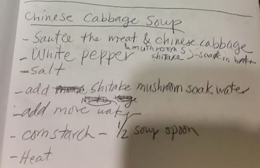

## Ingredients

- Meat
- Chinese cabbage
- Shiitake mushrooms, soaked in water (save the soaking water)
- White pepper
- Salt
- Water
- ½ soup spoon cornstarch

## Directions

1. Soak the shiitake mushrooms in water. Save the soaking water.
1. Sauté the meat, Chinese cabbage, and mushrooms.
1. Season with white pepper and salt.
1. Add the shiitake mushroom soaking water.
1. Add more water.
1. Add ½ soup spoon cornstarch.
1. Heat through.

## Notes

- The type of meat isn't specified (pork is typical), and there are no amounts for the meat, cabbage, mushrooms, seasonings, or water.
- "Mushrooms (shiitake) – soak in water" is squeezed in above the white pepper line. It's read here as adding the soaked mushrooms with the meat and cabbage.
- A word after "add" is crossed out (possibly "more"), and a word under the soaking-water line is scribbled out.
- "½ soup spoon" is assumed to mean a Chinese soup spoon (about 1 tablespoon). The card doesn't say whether to mix the cornstarch with water first; a slurry is usual.
- No simmering time is given.

**Similar recipes to fill in details**

- [Nom Nom Paleo: Pork and Napa Cabbage Soup](https://nomnompaleo.com/pork-and-napa-cabbage-soup): pork, napa cabbage, and shiitake soup; gives amounts and simmer time.
- [Earth to Veg: Napa Cabbage Soup with Mushrooms](https://earthtoveg.com/?p=26231): uses white pepper with napa cabbage and mushrooms.

## Source

