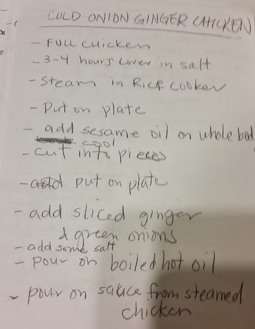

## Ingredients

- 1 whole chicken
- Salt, to cover the chicken, plus more for the topping
- Sesame oil
- Ginger, sliced
- Green onions
- Oil

## Directions

1. Cover the whole chicken in salt for 3-4 hours.
1. Steam the chicken in the rice cooker.
1. Put it on a plate and brush sesame oil over the whole body.
1. Let it cool.
1. Cut into pieces and put on a plate.
1. Add sliced ginger and green onions.
1. Add some salt.
1. Pour boiling-hot oil over the top.
1. Pour on the juices from the steamed chicken.

## Notes

- The card doesn't say whether to rinse the salt off before steaming, or whether the salting happens in the fridge.
- No steaming time or rice cooker setting is given.
- A word before "cool" is crossed out; "cool" is read here as letting the chicken cool before cutting, which is how the dish is usually served cold.
- No amounts for the sesame oil, ginger, green onions, or oil. The type of oil isn't stated (a neutral oil is typical).
- "Sliced ginger" may mean finely shredded or minced; most versions mince it so the hot oil can sizzle it.

**Similar recipes to fill in details**

- [Eat with Carmen: Hainanese Chicken in Rice Cooker](https://www.eatwithcarmen.com/hainanese-chicken-in-rice-cooker): cooking a whole chicken in a rice cooker, with timing.
- [Rasa Malaysia: Chicken Rice](https://rasamalaysia.com/wprm_print/chicken-rice): covers the ginger–scallion sauce and the hot-oil step.

## Source

