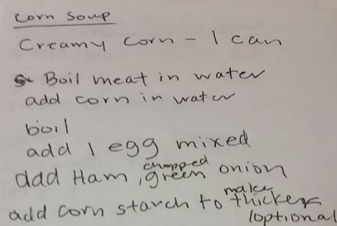

## Ingredients

- 1 can creamy corn
- Meat
- Water
- 1 egg, beaten
- Ham
- Green onion, chopped
- Cornstarch (optional)

## Directions

1. Boil the meat in water.
1. Add the corn to the water and bring to a boil.
1. Add the beaten egg.
1. Add the ham and chopped green onion.
1. If you'd like it thicker, add cornstarch.

## Notes

- "Creamy corn" is assumed to mean canned cream-style corn; the can size isn't given.
- The type and amount of meat aren't specified, and it's unclear whether it is separate from the ham.
- No amount of water is given.
- "Add 1 egg mixed" is read as a beaten egg, stirred in like egg drop soup.
- No amounts for the ham, green onion, or cornstarch. Cornstarch is usually mixed with a little cold water first.

**Similar recipes to fill in details**

- [Got It Cook It: Chinese Corn Velvet Soup](https://gotitcookit.blogspot.com/2014/02/chinese-corn-velvet-soup.html?m=0): cream-style corn, ham, egg, and a cornstarch slurry; gives amounts.
- [ET Food Voyage: Chinese Corn Egg Drop Soup](https://www.etfoodvoyage.com/?p=19395): explains how to add the egg.

## Source

