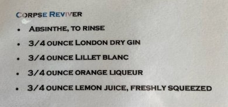

## Ingredients

- Absinthe, to rinse
- ¾ ounce London dry gin
- ¾ ounce Lillet Blanc
- ¾ ounce orange liqueur
- ¾ ounce lemon juice, freshly squeezed

## Directions

1. Rinse a chilled coupe with absinthe and pour out the excess.
1. Shake the gin, Lillet Blanc, orange liqueur, and lemon juice with ice until well chilled.
1. Strain into the rinsed glass.

## Notes

- The card lists only ingredients, so the directions above are the standard method for this drink, not from the card.
- These are the specs of the Corpse Reviver No. 2. The card doesn't name a garnish (a lemon or orange twist is common) or a specific orange liqueur (Cointreau is typical).

**Similar recipes to fill in details**

- [The Infatuation: How to Make a Corpse Reviver No. 2](https://www.theinfatuation.com/cocktails/c/cocktails-how-to-make-a-corpse-reviver-no-2): the same specs, with the rinse-and-shake method.
- [MasterClass: Classic Corpse Reviver No. 2](https://www.masterclass.com/articles/classic-corpse-reviver-no-2-cocktail-recipe): garnish options and substitutions.

## Source

