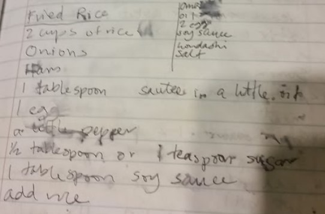

## Ingredients

- 2 cups rice
- Onions
- Ham
- 1 tablespoon oil
- 1 egg
- A little pepper
- ½ tablespoon or 1 teaspoon sugar
- 1 tablespoon soy sauce

## Directions

1. Sauté the onions and ham in a little oil.
1. Add the egg.
1. Season with pepper, sugar, and soy sauce.
1. Add the rice and stir-fry until combined.

## Notes

- "2 cups of rice" probably means cooked rice (day-old rice is typical), but the card doesn't say.
- "Ham" appears to be smudged or crossed out, and the "1 tablespoon" line ("1 tablespoon … sauté in a little oil") doesn't say 1 tablespoon of what. It's read here as 1 tablespoon oil.
- "A little" before pepper is crossed out.
- A second list in the top-right corner reads roughly "onion, oil, 2 eggs, soy sauce, Hondashi, salt" (the first word is smudged). It may be a variation with 2 eggs and Hondashi instead of 1 egg and sugar.
- The order of steps is inferred from the order of the list. It isn't clear whether the egg is scrambled separately first.
- No amounts for the onions or ham.

**Similar recipes to fill in details**

- [Just One Cookbook: Japanese Fried Rice (Yakimeshi)](https://www.justonecookbook.com/wprm_print/75644): ham, egg, and green onion fried rice; gives amounts and the order of steps.
- [The Country Cook: Ham Fried Rice](https://www.thecountrycook.net/ham-fried-rice/): ham, onion, egg, and soy sauce; gives amounts.

## Source

