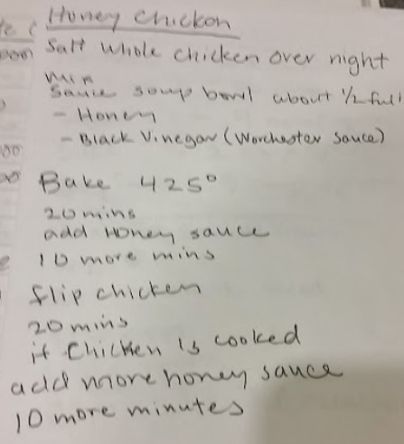

## Ingredients

- 1 whole chicken
- Salt

#### Honey sauce (about ½ soup bowl)

- Honey
- Black vinegar (or Worcestershire sauce)

## Directions

1. Salt the whole chicken and leave it overnight.
1. Mix the honey and black vinegar to make about half a soup bowl of sauce.
1. Bake the chicken at 425° for 20 minutes.
1. Add some of the honey sauce and bake 10 more minutes.
1. Flip the chicken and bake 20 minutes.
1. If the chicken is cooked, add more honey sauce and bake 10 more minutes.

## Notes

- "425°" is assumed to be °F. Total time is about 1 hour.
- The ratio of honey to black vinegar isn't given; together they fill a soup bowl about halfway.
- "(Worchester Sauce)" is in parentheses after black vinegar. It may be a substitute, or what was used at the time.
- No amount of salt, and the card doesn't say whether to refrigerate the chicken overnight (you should).
- The card doesn't say what to do if the chicken isn't cooked after the second 20 minutes; checking for 165°F in the thickest part of the thigh is a safe test.
- An earlier, shorter version is on the [peanut butter pasta](../peanut-butter-pasta/index.qmd) card: salt and pepper the chicken, soak for a couple of days, then bake with honey and soy sauce.

**Similar recipes to fill in details**

- [Food400: Roasted Honey Chicken](https://food400.com/2019/07/roasted-honey-chicken/): a whole chicken with a honey glaze at 425°F; gives times and glaze amounts.
- [Harry & David: Honey Balsamic Roasted Chicken](https://www.harryanddavid.com/blog/honey-balsamic-roasted-chicken): a honey-and-vinegar glaze for a whole chicken.

## Source

