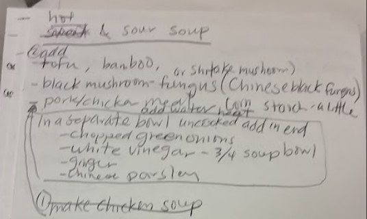

## Ingredients

- Chicken soup (broth)
- Tofu
- Bamboo shoots
- Shiitake mushrooms (optional)
- Black fungus (Chinese wood ear)
- Pork or chicken
- Water
- A little cornstarch

#### Add at the end (uncooked, mixed in a separate bowl)

- Chopped green onions
- ¾ soup bowl white vinegar
- Ginger
- Chinese parsley (cilantro)

## Directions

1. Make chicken soup.
1. Add the tofu, bamboo shoots, shiitake mushrooms (if using), black fungus, and pork or chicken.
1. Add water and heat.
1. Add a little cornstarch to thicken.
1. In a separate bowl, mix the green onions, white vinegar, ginger, and cilantro. Don't cook them; add them at the end.

## Notes

- The title was first written "sweet & sour soup"; "sweet" is crossed out and replaced with "hot."
- Step ① "make chicken soup" is crossed out on the card, so it may be optional, or store-bought broth may have been used instead. It's kept here.
- Nothing on the card makes the soup "hot." White pepper or chili oil is the usual source of heat; add to taste.
- "¾ soup bowl" of white vinegar is a lot; taste and adjust. Many recipes use black vinegar.
- No amounts for anything except the vinegar. Many versions also add a beaten egg at the end.
- The line "add water heat (corn starch – a little)" is squeezed in and partly hard to read.

**Similar recipes to fill in details**

- [Dinner, then Dessert: Hot and Sour Soup](https://dinnerthendessert.com/hot-and-sour-soup/): pork, tofu, bamboo shoots, and wood ear; gives amounts and a white pepper/vinegar balance.
- [No Recipes: Hot and Sour Soup](https://norecipes.com/hot-and-sour-soup/): explains rehydrating the fungus and adding vinegar at the end.

## Source

