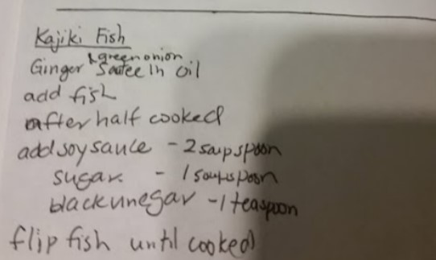

## Ingredients

- Kajiki (swordfish)
- Ginger
- Green onion
- Oil
- 2 soup spoons soy sauce
- 1 soup spoon sugar
- 1 teaspoon black vinegar

## Directions

1. Sauté the ginger and green onion in oil.
1. Add the fish.
1. When the fish is half cooked, add the soy sauce, sugar, and black vinegar.
1. Flip the fish and cook until done.

## Notes

- Kajiki is Japanese for swordfish/marlin; the amount of fish isn't given.
- "Soup spoon" is assumed to be a Chinese soup spoon, about 1 tablespoon.
- No amounts for the ginger, green onion, or oil.
- No heat level or cooking time is given.

**Similar recipes to fill in details**

- [RecipeTin Japan: Pan-Seared Swordfish with Ginger Soy Sauce](https://japan.recipetineats.com/wprm_print/pan-seared-swordfish-with-ginger-soy-sauce-swordfish-shogayaki): pan-seared kajiki with ginger and soy; gives fish size and cooking times.
- [RecipeTin Japan: Swordfish Teriyaki](https://japan.recipetineats.com/swordfish-teriyaki-recipe/): a sweet soy glaze on pan-fried swordfish.

## Source

