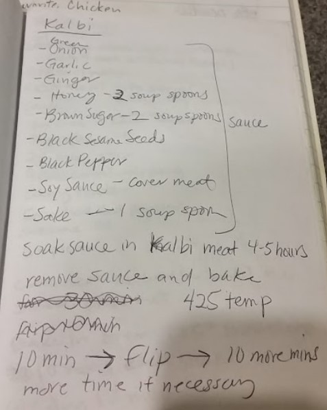

## Ingredients

- Kalbi (beef short ribs)

#### Sauce

- Green onion
- Garlic
- Ginger
- 2 soup spoons honey
- 2 soup spoons brown sugar
- Black sesame seeds
- Black pepper
- Soy sauce, enough to cover the meat
- 1 soup spoon sake

## Directions

1. Mix the sauce ingredients and soak the kalbi in the sauce for 4-5 hours.
1. Remove the meat from the sauce and bake at 425°.
1. Bake 10 minutes, flip, then bake 10 more minutes. Give it more time if necessary.

## Notes

- The amount of meat isn't given. "Kalbi meat" usually means flanken-cut short ribs.
- The honey amount is written over; it reads as 2 (possibly 3) soup spoons.
- "Soup spoon" is assumed to be a Chinese soup spoon, about 1 tablespoon.
- No amounts for the green onion, garlic, ginger, sesame seeds, or pepper.
- "425 temp" is assumed to be °F. A first attempt ("for 30 min") and another note are crossed out, replaced with 10 minutes per side.
- The card doesn't say whether to marinate in the fridge (you should).
- There's a cut-off heading at the top of the page ("… Chicken"), likely from the previous recipe.

**Similar recipes to fill in details**

- [Food52: Korean Kalbi](https://food52.com/recipes/8674-korean-kalbi/amp): a sake, honey, and brown sugar marinade; gives amounts.
- [Explore Cook Eat: How to Cook Korean Short Ribs in the Oven](https://explorecookeat.com/how-to-cook-korean-short-ribs-in-the-oven/): oven temperatures and times for flanken-cut ribs.

## Source

