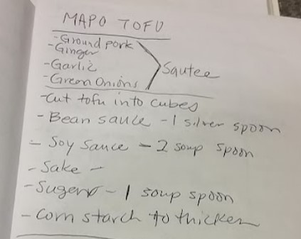

## Ingredients

- Ground pork
- Ginger
- Garlic
- Green onions
- Tofu, cut into cubes
- 1 silver spoon bean sauce
- 2 soup spoons soy sauce
- Sake
- 1 soup spoon sugar
- Cornstarch, to thicken

## Directions

1. Sauté the ground pork, ginger, garlic, and green onions.
1. Cut the tofu into cubes and add it.
1. Add the bean sauce, soy sauce, sake, and sugar.
1. Add cornstarch to thicken.

## Notes

- No amounts for the pork, ginger, garlic, green onions, tofu, or sake (the sake line has a dash but no amount).
- "Bean sauce" is likely chili bean paste (doubanjiang) or a similar fermented bean sauce; the card doesn't specify.
- "Silver spoon" is assumed to be a regular teaspoon/dinner spoon, and "soup spoon" a Chinese soup spoon (about 1 tablespoon).
- The order of adding the tofu and sauce, any water or broth, and cooking times aren't given. Cornstarch is usually mixed with water first.

**Similar recipes to fill in details**

- [Sudachi: Japanese-Style Mapo Tofu](https://sudachirecipes.com/wprm_print/japanese-style-mapo-tofu-mabodofu): a milder version with sake, sugar, and a cornstarch slurry; gives amounts.
- [RecipeTin Eats: Mapo Tofu](https://www.recipetineats.com/mapo-tofu-mince-tofu-spicy-sauce/): explains the order of steps and how much liquid to use.

## Source

