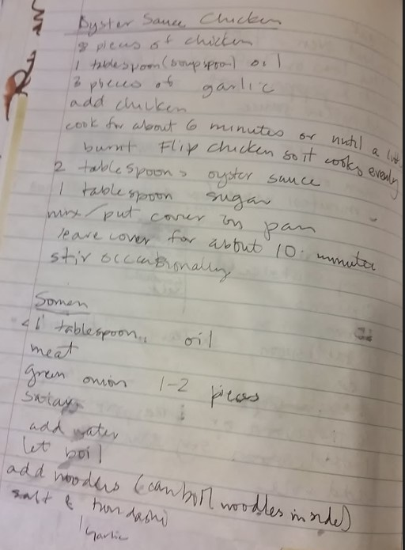

## Ingredients

- 8 pieces chicken
- 1 tablespoon (soup spoon) oil
- 3 pieces garlic
- 2 tablespoons oyster sauce
- 1 tablespoon sugar

## Directions

1. Heat the oil and add the garlic.
1. Add the chicken. Cook for about 6 minutes, or until a little burnt, flipping the chicken so it cooks evenly.
1. Add the oyster sauce and sugar and mix.
1. Put a cover on the pan and leave it covered for about 10 minutes, stirring occasionally.

## Notes

- The number of chicken pieces reads as 8 but could be 3. The cut (wings, drumsticks, thighs) isn't specified.
- "3 pieces of garlic" probably means 3 cloves. The card doesn't say whether to slice or crush them.
- No heat level is given.
- The same card also has a short recipe for **Somen**: about 1 tablespoon oil, meat, and 1-2 pieces green onion, sautéed; add water and let it boil; add the noodles (or boil the noodles on the side); season with salt and Hondashi; garlic. No amounts are given for the meat, water, or noodles.

**Similar recipes to fill in details**

- [Cup of Yum: Oyster Sauce Chicken](https://cupofyum.com/recipes/oyster-sauce-chicken): a simple, covered oyster sauce chicken with sugar and garlic.
- [Red House Spice: Oyster Sauce Chicken](https://redhousespice.com/oyster-sauce-chicken/): bone-in chicken pieces; gives amounts and cooking times.

## Source

