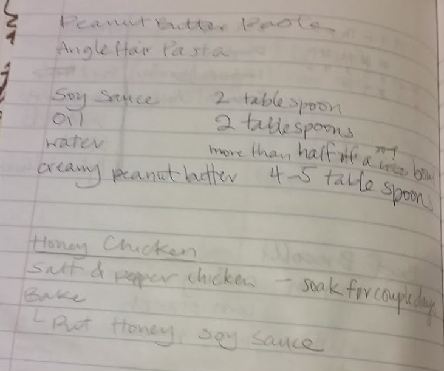

## Ingredients

- Angel hair pasta
- 2 tablespoons soy sauce
- 2 tablespoons oil
- Water, a little more than half a rice bowl
- 4-5 tablespoons creamy peanut butter

## Directions

1. Cook the angel hair pasta and drain.
1. Mix the soy sauce, oil, water, and peanut butter into a smooth sauce.
1. Toss the pasta with the sauce.

## Notes

- The card lists only ingredients, so the directions above are inferred, not from the card.
- The amount of pasta isn't given.
- The type of oil isn't specified (sesame oil would be typical).
- It's unclear whether the sauce is heated, or whether the water should be hot (warm water makes peanut butter smoother) or pasta water.
- The water line reads "more than half of a rice bowl," with "rice" partly crossed out.
- The same card has an early version of [honey chicken](../honey-chicken/index.qmd): salt and pepper the chicken, soak for a couple of days, bake, then put on honey and soy sauce.

**Similar recipes to fill in details**

- [Kikkoman: Easy Peanut Butter and Soy Sauce Noodles](https://kikkomanusa.com/homecooks/recipes/easy-peanut-butter-and-soy-sauce-noodles): a near-identical peanut butter, soy sauce, and water sauce; gives the method.
- [The Mom 100: Noodles with Peanut Sauce](https://themom100.com/recipe/noodles-with-peanut-sauce): angel hair with peanut butter, soy sauce, and hot water; gives pasta amounts.

## Source

