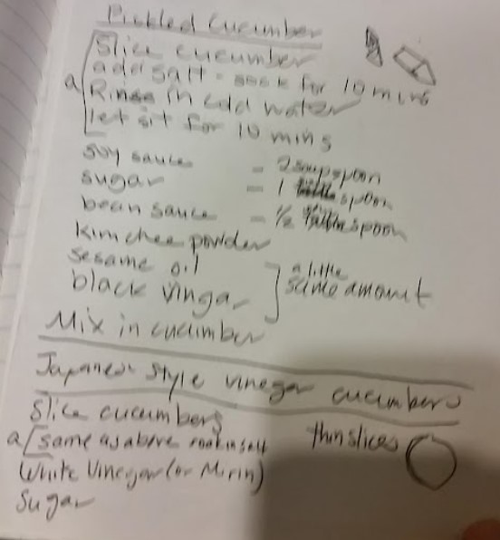

## Ingredients

- Cucumber
- Salt

#### Sauce

- 2 soup spoons soy sauce
- 1 spoon sugar
- ½ spoon bean sauce
- Kimchee powder
- Sesame oil
- Black vinegar

## Directions

1. Slice the cucumber.
1. Add salt and soak for 10 minutes.
1. Rinse in cold water.
1. Let sit for 10 minutes.
1. Mix the soy sauce, sugar, bean sauce, kimchee powder, sesame oil, and black vinegar.
1. Mix in the cucumber.

## Notes

- The type and number of cucumbers aren't given.
- The unit for the sugar is overwritten (it reads "1 [tea]spoon" or "1 soup spoon"), and the unit for the bean sauce is unclear ("½ … spoon").
- The kimchee powder, sesame oil, and black vinegar are bracketed with "a little, same amount" — use a little of each, in equal amounts.
- "Kimchee powder" is probably Korean chili flakes (gochugaru). "Bean sauce" may be chili bean paste or a Korean bean paste.
- The bracket "a" next to the salting steps marks them as step "a," which the variation below reuses.
- The same card has a **Japanese-style vinegar cucumber** variation: slice the cucumbers thin, soak in salt as above, then dress with white vinegar (or mirin) and sugar. No amounts are given.

**Similar recipes to fill in details**

- [Beyond Kimchee: Spicy Korean Cucumber Salad (Oi Muchim)](https://www.beyondkimchee.com/spicy-korean-cucumber-salad/): salted, rinsed cucumbers with soy, gochugaru, sesame oil, and vinegar; gives amounts.
- [My Korean Kitchen: Korean Cucumber Salad](https://mykoreankitchen.com/?p=6901): explains the salting and rinsing step.

## Source

