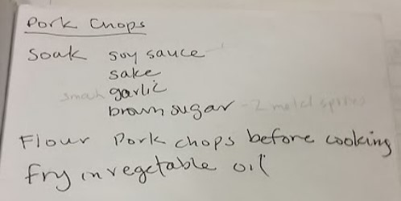

## Ingredients

- Pork chops
- Flour
- Vegetable oil

#### Marinade

- Soy sauce
- Sake
- Garlic, smashed
- 2 metal spoons brown sugar

## Directions

1. Soak the pork chops in the soy sauce, sake, smashed garlic, and brown sugar.
1. Flour the pork chops before cooking.
1. Fry in vegetable oil.

## Notes

- No amounts for the pork chops, soy sauce, or sake.
- "2 metal spoons" is written faintly; a "metal spoon" is probably a regular eating spoon, roughly a teaspoon to a tablespoon.
- "Smash" is written faintly next to the garlic.
- No marinating time, pork chop thickness, or frying time is given.

**Similar recipes to fill in details**

- [LCA Recipes: Asian Pork Chops](https://lcarecipes.com/wprm_print/asian-pork-chops): floured, pan-fried pork chops with sake, soy, and garlic; gives amounts and times.
- [Umami Recipes: Asian Pork Chop with Ginger Soy Sauce](https://www.umami.recipes/recipe/PpiSZ33qBxzXQB5lb45X): a soy/sake/sugar/garlic marinade; recommends about 30 minutes of marinating.

## Source

