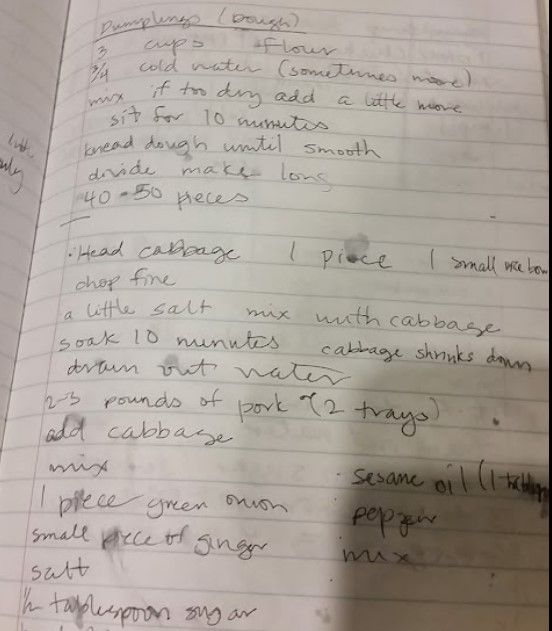

## Ingredients

#### Dough

- 3 cups flour
- ¾ cold water (sometimes more)

#### Filling

- 1 head cabbage
- A little salt, for the cabbage
- 2-3 pounds pork (2 trays)
- 1 piece green onion
- 1 small piece ginger
- Salt
- ½ tablespoon sugar
- 1 tablespoon sesame oil
- Pepper

## Directions

1. For the dough, mix the flour and cold water. If it's too dry, add a little more water.
1. Let sit for 10 minutes.
1. Knead the dough until smooth.
1. Divide and roll into logs, then cut into 40-50 pieces.
1. For the filling, chop the cabbage fine.
1. Mix the cabbage with a little salt and soak for 10 minutes. The cabbage will shrink down.
1. Drain out the water.
1. Add the cabbage to the pork and mix.
1. Add the green onion, ginger, salt, sugar, sesame oil, and pepper, and mix.

## Notes

- The water amount reads "¾" with no unit; ¾ cup is the likely reading for 3 cups of flour, though most recipes use closer to 1 cup.
- "1 piece – 1 small rice bowl" is written next to the cabbage. It may mean 1 head yields about 1 small rice bowl once chopped and drained, or that 1 small rice bowl of chopped cabbage is enough.
- The type of cabbage (napa or green) and the cut of pork (ground) aren't specified.
- No amount of salt for the filling, and the sesame oil amount is cut off ("1 tabl…"); 1 tablespoon is assumed.
- The green onion and ginger are probably minced, but the card doesn't say.
- The card ends after the filling. It doesn't explain rolling the wrappers, filling and folding, or how to cook the dumplings (boiled, steamed, or pan-fried).
- Faint notes in the left margin are cut off and can't be read.

**Similar recipes to fill in details**

- [Tara's Multicultural Table: Chinese Pork and Cabbage Dumplings](https://tarasmulticulturaltable.com/jiaozi-chinese-dumplings/): a 3-cup-flour dough and a salted-cabbage filling; covers rolling, folding, and boiling.
- [Mission Food: Pork and Cabbage Dumplings](https://mission-food.com/pork-and-cabbage-dumplings/): explains salting and squeezing the cabbage, and how to fold.

## Source

