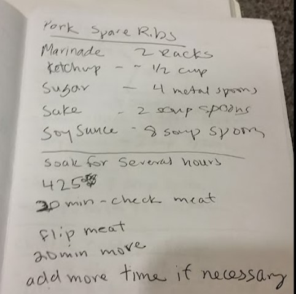

## Ingredients

- 2 racks pork spare ribs

#### Marinade

- ½ cup ketchup
- 4 metal spoons sugar
- 2 soup spoons sake
- 8 soup spoons soy sauce

## Directions

1. Mix the marinade and soak the ribs for several hours.
1. Bake at 425° for 30 minutes, then check the meat.
1. Flip the meat and bake 20 minutes more.
1. Add more time if necessary.

## Notes

- The ketchup is "~½ cup" (about).
- The soy sauce amount reads as 8 soup spoons; it could be 3.
- "Metal spoon" is probably a regular eating spoon, and "soup spoon" a Chinese soup spoon (about 1 tablespoon).
- "425" is assumed to be °F; something after it is scribbled out. The first bake time is written over (30, possibly 20).
- The card doesn't say whether to cover the ribs or marinate in the fridge (you should).

**Similar recipes to fill in details**

- [RecipeTin Eats: Sticky Chinese Pork Spare Ribs](https://www.recipetineats.com/sticky-chinese-pork-spare-ribs/): oven-baked ribs with a ketchup/soy/sugar sauce; a reader comment describes baking at 425°F.
- [Oven-Baked Japanese Spare Ribs (Cascade Organic)](https://cascade-organic.squarespace.com/recipes/2025/1/23/oven-baked-japanese-spare-ribs): a sake, soy, and sugar marinade.

## Source

