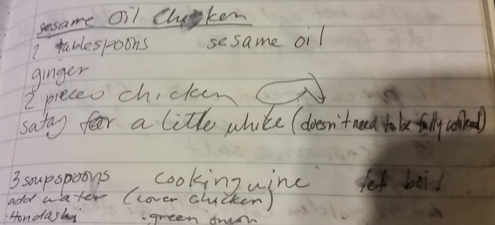

## Ingredients

- 2 tablespoons sesame oil
- Ginger
- 2 pieces chicken
- 3 soup spoons cooking wine
- Water, to cover the chicken
- Hondashi
- Green onion

## Directions

1. Heat the sesame oil and add the ginger.
1. Add the chicken and sauté for a little while. It doesn't need to be fully cooked.
1. Add the cooking wine and enough water to cover the chicken. Let it boil.
1. Season with Hondashi and add green onion.

## Notes

- "2 pieces chicken" has a small drawing next to it, possibly of a drumstick or thigh, so the cut is unclear.
- No amounts for the ginger, Hondashi, or green onion. Ginger is traditionally sliced and fried in the oil until it shrivels.
- The type of sesame oil (black or regular toasted) isn't given; Taiwanese sesame oil chicken traditionally uses black sesame oil.
- "Soup spoon" is assumed to be a Chinese soup spoon, about 1 tablespoon. The type of cooking wine (rice wine is traditional) isn't given.
- No simmering time. The bottom of the photo is cut off just after "Hondashi" and "green onion," so there may be more steps.
- See also [sesame oil noodle soup](../sesame-oil-noodle-soup/index.qmd), a similar recipe served over somen.

**Similar recipes to fill in details**

- [Saveur: Sesame Oil Chicken (Ma You Ji)](https://www.saveur.com/article/Recipes/Sesame-Oil-Chicken-Ma-You-Ji): the classic version; gives chicken, ginger, and wine amounts and simmer time.
- [Assorted Eats: Taiwanese Sesame Oil Chicken Soup](https://www.assortedeats.com/taiwanese-sesame-oil-chicken-soup/): explains frying the ginger and balancing wine and water.

## Source

