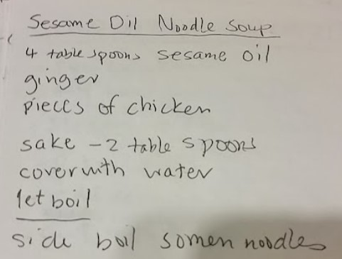

## Ingredients

- 4 tablespoons sesame oil
- Ginger
- Pieces of chicken
- 2 tablespoons sake
- Water, to cover
- Somen noodles

## Directions

1. Heat the sesame oil and add the ginger.
1. Add the chicken pieces.
1. Add the sake and cover with water. Let it boil.
1. On the side, boil the somen noodles.

## Notes

- No amounts for the ginger, chicken, or noodles, and the cut of chicken isn't specified.
- The card doesn't say how long to cook the chicken before adding the sake, or how long to simmer.
- No salt or seasoning is listed. Most versions season to taste at the end and garnish with green onion; the [sesame oil chicken](../sesame-oil-chicken/index.qmd) card adds Hondashi.
- The card doesn't say how to serve. Usually the cooked noodles go in a bowl and the soup is ladled over just before eating.

**Similar recipes to fill in details**

- [What To Cook Today: Easy Taiwanese Sesame Wine Chicken Mee Sua](https://whattocooktoday.com/sesame-wine-chicken-mee-sua.html): gives amounts (800 g chicken, 4 tbsp sesame oil) for four servings.
- [Sea Salt with Food: Sesame Wine Chicken with Somen](https://seasaltwithfood.com/2014/11/sesame-wine-chicken-with-somenmee-sua.html?m=1): the same dish served over somen.

## Source

