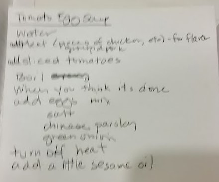

## Ingredients

- Water
- Meat (pieces of chicken, ground pork, etc.), for flavor
- Tomatoes, sliced
- Eggs, mixed
- Salt
- Chinese parsley (cilantro)
- Green onion
- A little sesame oil

## Directions

1. Bring water to a boil and add the meat for flavor.
1. Add the sliced tomatoes.
1. Boil.
1. When you think it's done, add the mixed eggs.
1. Add salt, cilantro, and green onion.
1. Turn off the heat.
1. Add a little sesame oil.

## Notes

- The photo is blurry, so some words are best guesses. "Ground pork" is written small under "pieces of chicken, etc."
- A word after "Boil" is crossed out.
- No amounts for anything: water, meat, tomatoes, or eggs.
- "When you think it's done" has no time; the tomatoes are usually simmered until soft. Most recipes pour the beaten eggs in slowly while stirring, to make ribbons.

**Similar recipes to fill in details**

- [The Woks of Life: Tomato Egg Drop Soup](https://thewoksoflife.com/tomato-egg-drop-soup/): gives amounts and explains how to add the egg.
- [Omnivore's Cookbook: Tomato Egg Drop Soup](https://omnivorescookbook.com/tomato-egg-drop-soup/): finishes with sesame oil and cilantro off the heat.

## Source

