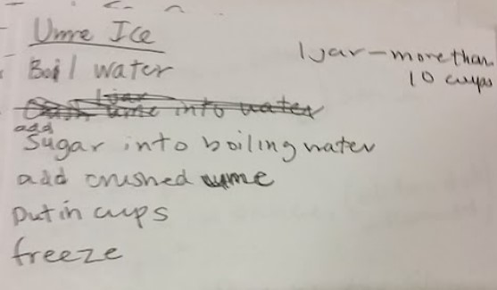

## Ingredients

- Water, more than 10 cups
- Sugar
- 1 jar ume, crushed

## Directions

1. Boil the water.
1. Add sugar to the boiling water.
1. Add the crushed ume.
1. Pour into cups.
1. Freeze.

## Notes

- The side note "1 jar – more than 10 cups" is read as 1 jar of ume to more than 10 cups of water, but it could also mean the batch makes more than 10 cups. The jar size isn't given.
- No amount of sugar.
- The kind of ume isn't specified. It's likely salted pickled plums (umeboshi) or a sweet/dried plum; umeboshi are very salty, so taste before freezing.
- A first attempt at step 2, "crush ume into water" (with "1 jar" above it), is crossed out and replaced with adding the sugar first, then the crushed ume.
- The card doesn't say whether to strain out the pits or how big the cups should be.

**Similar recipes to fill in details**

- [Just One Cookbook: Ume Plum Syrup](https://www.justonecookbook.com/ume-plum-syrup): a sweet ume base that could guide the sugar-to-ume ratio.
- [No Recipes: Ume Juice (Plum Syrup)](https://norecipes.com/ume-juice-plum-syrup/): explains diluting ume syrup with water, useful for proportions.

## Source

